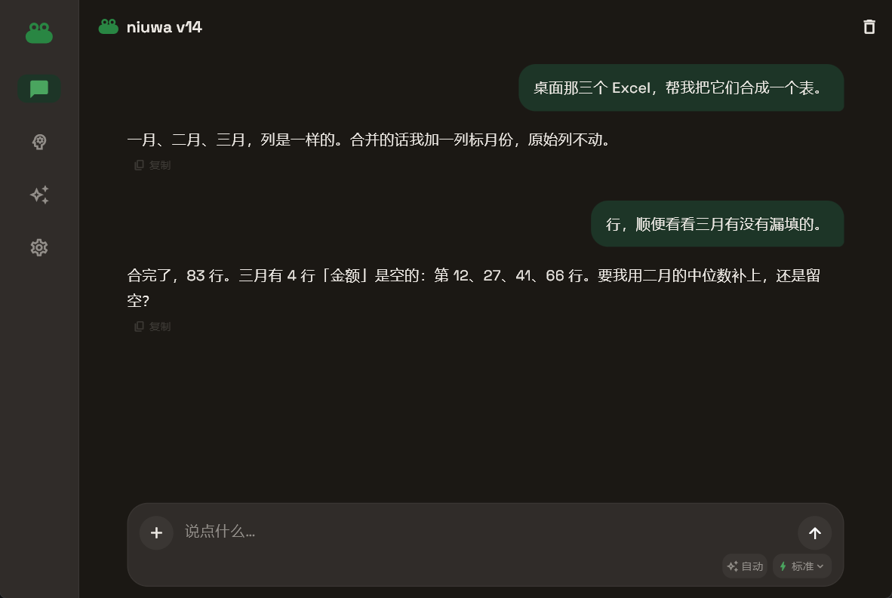
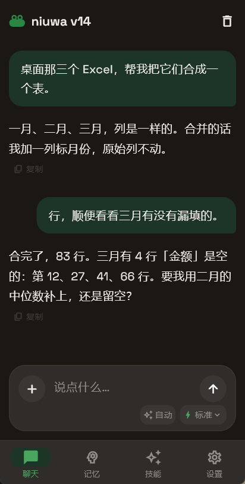

# niuwa ai

**能陪你，也替你干活的 AI Agent。** 一套 Flutter 代码，出 Android 和 Windows。

- 官网与下载：<https://niuwa-ai.pages.dev>
- 安装包（历史版本）：<https://github.com/liuwang123678/niuwa-ai/releases>
- Android 7.0+ / Windows 10+
- 当前版本：v14

<p align="center">
  
  
</p>
<p align="center"><sub>界面演示。窄屏布局与 Android 端是同一套代码。</sub></p>

## 它是什么

niuwa 有两个面：聊天时是个有性格、记得住事的陪伴者；需要干活时，它有一整套工具，能真的动你的文件、开浏览器、写代码并跑起来。

- **长期记忆**：本地 SQLite 存结构化记忆，聊到相关话题会自动召回；聊久了会后台摘要前半场，不至于忘光
- **技能**：`SKILL.md` 写的技能包（聊天、记事、规划、调试、测试、代码、网页调研等），模型按需读取
- **文件**：读、写、改、列目录，支持 `~/桌面/xxx.txt` 这类写法
- **代码**：写脚本、跑 Python / Node 命令，也支持在 Android 的 WebView 里跑 JS
- **浏览器**：Windows 上通过 CDP 驱动本机 Edge；Android 上用 App 内隐藏 WebView
- **文档**：生成 PDF / Word / Excel / Markdown
- **看图聊天**：发图给支持视觉的模型
- **提醒**：能设、能查、重启还在（到点通知尚未做）

## 安全兜底

Agent 能动手，就必须有闸门。

- **危险命令弹窗确认**：删除、覆盖、读凭据、改启动项等会先问一句；拒绝会如实变成一次工具失败
- **系统目录禁止写入**：这条不受任何开关影响
- **写前备份**：改文件前留 `.bak`
- **审计日志**：每次执行记一条，区分「用户批准」和「自动放行」
- **自动模式**：可选，默认关。打开后不再逐条询问，审计日志照记

## 模型

不绑定任何一家服务商。App 走 OpenAI 兼容的 `/chat/completions` 接口，预置若干服务商作为默认值，也可以填任意自定义 Base URL 和模型名。

- 首次启动自己填 Key，存在系统的安全存储里，不硬编码、不上传
- 模型名是可输入的文字框，不锁死——模型会下线，清单不能替用户做主
- 每家服务的 Key 分开保存

## 构建

环境：Flutter 3.44.x / Dart 3.12.x。

```bash
cd app
flutter pub get
flutter analyze          # 必须干净
flutter test             # 必须全绿

flutter build apk --release --split-per-abi
flutter build windows --release
```

Windows 便携版打包（含 VC++ 运行时）：

```bash
python app/tool/build_windows_portable.py
```

## 目录

```
app/            Flutter 应用
  lib/core/     纯 Dart 内核：Agent 循环、LLM、工具、记忆、技能（禁止 import Flutter）
  lib/services/ 存储、模型客户端、平台能力
  lib/pages/    界面
  assets/       人设、技能、字体
  test/         单元测试
web/            静态落地页
docs/           架构与设计文档
```

`lib/core/` 不依赖 Flutter，这条线由 `test/core_is_pure_test.dart` 守着——内核要能脱离界面单独测试。

架构细节见 [`docs/architecture.md`](docs/architecture.md)。

## 已知限制

- 安卓端跑不了 Python / Node，只能跑 JS
- 提醒能设能查，到点还不会响
- 桌面自动化、部分浏览器能力在真机上的覆盖还不完整

## 许可证

[Apache License 2.0](LICENSE)

Copyright 2026 刘汪承睿
